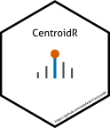

<!-- README.md is generated from README.qmd. Please edit that file -->

# CentroidR 

<!-- badges: start -->

[](https://lifecycle.r-lib.org/articles/stages.html#experimental)
[](https://github.com/adafede/CentroidR/actions/workflows/R-CMD-check.yaml)
[](https://app.codecov.io/gh/adafede/CentroidR)
[](https://adafede.r-universe.dev/CentroidR)
[](https://hub.docker.com/r/adafede/centroidr/)
[](https://doi.org/10.5281/zenodo.17250307)
<!-- badges: end -->

Experimental R package and CLI for centroiding profile-mode `mzML` mass spectra.

Inspired by the original workflow at
<https://github.com/EuracBiomedicalResearch/batch_centroid>, `CentroidR`
supports independent MS1 and MS2 tolerances, 1D Morse-Smale topological
prominence valley splitting, optional local edge-baseline subtraction,
power-weighted or apex-centered log-quadratic Gaussian m/z estimation, 2-pass
Gauss-Seidel multiplet tail subtraction, and analyzer-specific m/z domain
scaling (`legacy`, `linear`, `tof`, `orbitrap`, `fticr`).

## Requirements

- **Profile-mode `mzML` files** (`R >= 4.5.0` when running outside Docker).

Vendor raw files (including Sciex `.wiff` and `.wiff2`) can be converted to
profile `mzML` first with ProteoWizard `msconvert`:

```bash
docker run -it --rm -e WINEDEBUG=-all -v .:/data \
  proteowizard/pwiz-skyline-i-agree-to-the-vendor-licenses \
  wine msconvert "/data/raw/spectra.wiff" --ignoreUnknownInstrumentError
```

## Installation

`CentroidR` is not on CRAN; install it from R-universe:

```r
install.packages(
  "CentroidR",
  repos = c(
    "https://adafede.r-universe.dev",
    "https://bioc-release.r-universe.dev",
    "https://cloud.r-project.org"
  )
)
```

## Use

### Single file

```r
CentroidR::centroid_one_file(
  file = "path_to_your/profile/spectra.mzML",
  pattern = "/profile/",
  replacement = "/profile_centroided/"
)
```

For Gaussian m/z centroiding, continuous apex interpolation, multiplet tail
subtraction, baseline subtraction, and TOF domain scaling:

```r
CentroidR::centroid_one_file(
  file = "path_to_your/profile/spectra.mzML",
  pattern = "/profile/",
  replacement = "/profile_centroided/",
  centroid_method = "gaussian",
  intensity_method = "gaussian_apex",
  deconvolve = TRUE,
  baseline_subtract = TRUE,
  domain_scaling = "tof"
)
```

From the command line:

```bash
Rscript inst/scripts/centroiding.R \
  --file "path_to_your/profile/spectra.mzML" \
  --pattern "/profile/" \
  --replacement "/profile_centroided/"
```

### Multiple files

```r
"path_to_your/profiles/" |>
  list.files(pattern = "\\.mzML$", full.names = TRUE) |>
  lapply(
    CentroidR::centroid_one_file,
    pattern = "/profiles/",
    replacement = "/profiles_centroided/"
  )
```

From the command line:

```bash
Rscript inst/scripts/centroiding.R \
  --directory "path_to_your/profiles/" \
  --pattern "/profiles/" \
  --replacement "/profiles_centroided/"
```

```bash
Rscript inst/scripts/centroiding.R --help
```

### Docker

```bash
docker pull adafede/centroidr
# Build from source:
# docker build -f inst/Dockerfile -t adafede/centroidr .
```

The container sets `WORKDIR /home/bioc-user` with `centroiding.R` in the working
directory, so mount host data to `/data`:

```bash
docker run --rm \
  -v /path/to/your:/data \
  adafede/centroidr \
  Rscript centroiding.R \
    --file "/data/profile/spectra.mzML" \
    --pattern "/profile/" \
    --replacement "/profile_centroided/"
```

```bash
docker run --rm \
  -v /path/to/your:/data \
  adafede/centroidr \
  Rscript centroiding.R \
    --directory "/data/profiles/" \
    --pattern "/profiles/" \
    --replacement "/profiles_centroided/"
```

To print all CLI options:

```bash
docker run --rm adafede/centroidr Rscript centroiding.R --help
```

## Limitations

- **Format**: Only `mzML` input and output via `Spectra::MsBackendMzR()` are
  supported. Vendor raw files must be converted to profile `mzML` beforehand.
- **MS levels**: MS1 and MS2 scans are centroided with independent parameters;
  MS3+ or missing-level scans are preserved unmodified in original chronological
  order.
- **Parallelism**: Processing within a single file runs serially
  (`BiocParallel::SerialParam()`) in batches of up to 5000 spectra; parallelize
  across files at the caller level if needed.
- **Output handling**: Output paths that resolve to the input file itself are
  refused (`FALSE`) to prevent in-place overwrite, while already-existing output
  files are skipped (`TRUE`).

## Citation

Rutz, Adriano, and Johannes Rainer. 2026. *CentroidR: Centroid Profile Mass
Spectrometry Data*. R package version 0.0.0.9005.
<https://doi.org/10.5281/zenodo.17250307>.

## Additional software credits

  | Package      | Version    | Citation                                                                                                           |
  | :---         | :---       | :---                                                                                                               |
  | base         | 4.6.2      | R Core Team (2026)                                                                                                 |
  | BiocManager  | 1.30.27    | Morgan and Ramos (2025)                                                                                            |
  | BiocParallel | 1.46.0     | Wang et al. (2026)                                                                                                 |
  | BiocVersion  | 3.23.1     | Morgan (2025)                                                                                                      |
  | CentroidR    | 0.0.0.9005 | Rutz and Rainer (2026)                                                                                             |
  | knitr        | 1.52       | Xie (2014); Xie (2015); Xie (2026)                                                                                 |
  | MsCoreUtils  | 1.24.0     | Rainer et al. (2022a)                                                                                              |
  | mzR          | 2.45.3     | Pedrioli et al. (2004); Keller et al. (2005); Kessner et al. (2008); Martens et al. (2010); Chambers et al. (2012) |
  | rmarkdown    | 2.32       | Xie et al. (2018); Xie et al. (2020); Allaire et al. (2026)                                                        |
  | Spectra      | 1.22.2     | Rainer et al. (2022b)                                                                                              |
  | tinytest     | 1.4.3      | <span class="nocase">van der Loo</span> (2020)                                                                     |

<div id="refs" class="references csl-bib-body hanging-indent">

<div id="ref-rmarkdown2026" class="csl-entry">

Allaire, JJ, Yihui Xie, Christophe Dervieux, et al. 2026.
*<span class="nocase">rmarkdown</span>: Dynamic Documents for r*.
<https://github.com/rstudio/rmarkdown>.

</div>

<div id="ref-mzR2012" class="csl-entry">

Chambers, Matthew C., Maclean, et al. 2012. “<span class="nocase">A
cross-platform toolkit for mass spectrometry and proteomics</span>.”
*Nat Biotech* 30 (10): 918–20. <https://doi.org/10.1038/nbt.2377>.

</div>

<div id="ref-mzR2005" class="csl-entry">

Keller, Andrew, Jimmy Eng, Ning Zhang, Xiao-jun Li, and Ruedi Aebersold.
2005. “A Uniform Proteomics MS/MS Analysis Platform Utilizing Open XML
File Formats.” *Mol Syst Biol*.

</div>

<div id="ref-mzR2008" class="csl-entry">

Kessner, Darren, Matt Chambers, Robert Burke, David Agus, and Parag
Mallick. 2008. “ProteoWizard: Open Source Software for Rapid Proteomics
Tools Development.” *Bioinformatics* 24 (21): 2534–36.
<https://doi.org/10.1093/bioinformatics/btn323>.

</div>

<div id="ref-mzR2010" class="csl-entry">

Martens, Lennart, Matthew Chambers, Marc Sturm, et al. 2010. “MzML - a
Community Standard for Mass Spectrometry Data.” *Mol Cell Proteomics*,
ahead of print. <https://doi.org/10.1074/mcp.R110.000133>.

</div>

<div id="ref-BiocVersion" class="csl-entry">

Morgan, Martin. 2025. *BiocVersion: Set the Appropriate Version of
Bioconductor Packages*.

</div>

<div id="ref-BiocManager" class="csl-entry">

Morgan, Martin, and Marcel Ramos. 2025. *BiocManager: Access the
Bioconductor Project Package Repository*.
<https://doi.org/10.32614/CRAN.package.BiocManager>.

</div>

<div id="ref-mzR2004" class="csl-entry">

Pedrioli, Patrick G A, Jimmy K Eng, Robert Hubley, et al. 2004. “A
Common Open Representation of Mass Spectrometry Data and Its Application
to Proteomics Research.” *Nat Biotechnol* 22 (11): 1459–66.
<https://doi.org/10.1038/nbt1031>.

</div>

<div id="ref-base" class="csl-entry">

R Core Team. 2026. *R: A Language and Environment for Statistical
Computing*. R Foundation for Statistical Computing.
<https://doi.org/10.32614/R.manuals>.

</div>

<div id="ref-MsCoreUtils" class="csl-entry">

Rainer, Johannes, Andrea Vicini, Liesa Salzer, et al. 2022a. “A Modular
and Expandable Ecosystem for Metabolomics Data Annotation in r.”
*Metabolites* 12: 173. <https://doi.org/10.3390/metabo12020173>.

</div>

<div id="ref-Spectra" class="csl-entry">

Rainer, Johannes, Andrea Vicini, Liesa Salzer, et al. 2022b. “A Modular
and Expandable Ecosystem for Metabolomics Data Annotation in r.”
*Metabolites* 12: 173. <https://doi.org/10.3390/metabo12020173>.

</div>

<div id="ref-CentroidR" class="csl-entry">

Rutz, Adriano, and Johannes Rainer. 2026. *CentroidR: Centroid Profile
Mass Spectrometry Data*. <https://doi.org/10.5281/zenodo.17250307>.

</div>

<div id="ref-tinytest" class="csl-entry">

<span class="nocase">van der Loo, MPJ</span>. 2020. “A Method for
Deriving Information from Running r Code.” *The R Journal* 13: 42–52.
<https://journal.r-project.org/articles/RJ-2021-056/>.

</div>

<div id="ref-BiocParallel" class="csl-entry">

Wang, Jiefei, Martin Morgan, Valerie Obenchain, Michel Lang, Ryan
Thompson, and Nitesh Turaga. 2026. *BiocParallel: Bioconductor
Facilities for Parallel Evaluation*.
<https://doi.org/10.18129/B9.bioc.BiocParallel>.

</div>

<div id="ref-knitr2014" class="csl-entry">

Xie, Yihui. 2014. “<span class="nocase">knitr</span>: A Comprehensive
Tool for Reproducible Research in R.” In *Implementing Reproducible
Computational Research*, edited by Victoria Stodden, Friedrich Leisch,
and Roger D. Peng. Chapman; Hall/CRC.

</div>

<div id="ref-knitr2015" class="csl-entry">

Xie, Yihui. 2015. *Dynamic Documents with R and Knitr*. 2nd ed. Chapman;
Hall/CRC. <https://yihui.org/knitr/>.

</div>

<div id="ref-knitr2026" class="csl-entry">

Xie, Yihui. 2026. *<span class="nocase">knitr</span>: A General-Purpose
Package for Dynamic Report Generation in R*. <https://yihui.org/knitr/>.

</div>

<div id="ref-rmarkdown2018" class="csl-entry">

Xie, Yihui, J. J. Allaire, and Garrett Grolemund. 2018. *R Markdown: The
Definitive Guide*. Chapman; Hall/CRC.
<https://pkg.yihui.org/rmarkdown-book/>.

</div>

<div id="ref-rmarkdown2020" class="csl-entry">

Xie, Yihui, Christophe Dervieux, and Emily Riederer. 2020. *R Markdown
Cookbook*. Chapman; Hall/CRC.
<https://pkg.yihui.org/rmarkdown-cookbook/>.

</div>

</div>
