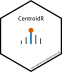

---
format:
  gfm: default
  html: default
bibliography: grateful-refs.bib
---

<!-- README.md is generated from README.qmd. Please edit that file -->

```{r}
#| label: knitr
#| include: false

knitr::opts_chunk$set(
  collapse = TRUE,
  comment = "#>",
  fig.path = "man/figures/README-",
  out.width = "100%"
)
```

# CentroidR 

<!-- badges: start -->
[](https://lifecycle.r-lib.org/articles/stages.html#experimental)
[](https://github.com/adafede/CentroidR/actions/workflows/R-CMD-check.yaml)
[](https://app.codecov.io/gh/adafede/CentroidR)
[](https://adafede.r-universe.dev/CentroidR)
[](https://hub.docker.com/r/adafede/centroidr/)
[](https://doi.org/10.5281/zenodo.17250307)
<!-- badges: end -->

Experimental R package and CLI for centroiding profile-mode `mzML` mass spectra.

Inspired by the original workflow at
<https://github.com/EuracBiomedicalResearch/batch_centroid>, `CentroidR`
supports independent MS1 and MS2 tolerances, 1D Morse-Smale topological
prominence valley splitting, optional local edge-baseline subtraction,
power-weighted or apex-centered log-quadratic Gaussian m/z estimation, 2-pass
Gauss-Seidel multiplet tail subtraction, and analyzer-specific m/z domain
scaling (`legacy`, `linear`, `tof`, `orbitrap`, `fticr`).

## Requirements

- **Profile-mode `mzML` files** (`R >= 4.5.0` when running outside Docker).

Vendor raw files (including Sciex `.wiff` and `.wiff2`) can be converted to
profile `mzML` first with ProteoWizard `msconvert`:

```bash
docker run -it --rm -e WINEDEBUG=-all -v .:/data \
  proteowizard/pwiz-skyline-i-agree-to-the-vendor-licenses \
  wine msconvert "/data/raw/spectra.wiff" --ignoreUnknownInstrumentError
```

## Installation

`CentroidR` is not on CRAN; install it from R-universe:

```r
install.packages(
  "CentroidR",
  repos = c(
    "https://adafede.r-universe.dev",
    "https://cran.r-universe.dev",
    "https://bioc.r-universe.dev"
  )
)
```

## Use

### Single file

```r
CentroidR::centroid_one_file(
  file = "path_to_your/profile/spectra.mzML",
  pattern = "/profile/",
  replacement = "/profile_centroided/"
)
```

For Gaussian m/z centroiding, continuous apex interpolation, multiplet tail
subtraction, baseline subtraction, and TOF domain scaling:

```r
CentroidR::centroid_one_file(
  file = "path_to_your/profile/spectra.mzML",
  pattern = "/profile/",
  replacement = "/profile_centroided/",
  centroid_method = "gaussian",
  intensity_method = "gaussian_apex",
  deconvolve = TRUE,
  baseline_subtract = TRUE,
  domain_scaling = "tof"
)
```

From the command line:

```bash
Rscript inst/scripts/centroiding.R \
  --file "path_to_your/profile/spectra.mzML" \
  --pattern "/profile/" \
  --replacement "/profile_centroided/"
```

### Multiple files

```r
"path_to_your/profiles/" |>
  list.files(pattern = "\\.mzML$", full.names = TRUE) |>
  lapply(
    CentroidR::centroid_one_file,
    pattern = "/profiles/",
    replacement = "/profiles_centroided/"
  )
```

From the command line:

```bash
Rscript inst/scripts/centroiding.R \
  --directory "path_to_your/profiles/" \
  --pattern "/profiles/" \
  --replacement "/profiles_centroided/"
```

```bash
Rscript inst/scripts/centroiding.R --help
```

### Docker

```bash
docker pull adafede/centroidr
# Build from source:
# docker build -f inst/Dockerfile -t adafede/centroidr .
```

The container sets `WORKDIR /home/bioc-user` with `centroiding.R` in the working
directory, so mount host data to `/data`:

```bash
docker run --rm \
  -v /path/to/your:/data \
  adafede/centroidr \
  Rscript centroiding.R \
    --file "/data/profile/spectra.mzML" \
    --pattern "/profile/" \
    --replacement "/profile_centroided/"
```

```bash
docker run --rm \
  -v /path/to/your:/data \
  adafede/centroidr \
  Rscript centroiding.R \
    --directory "/data/profiles/" \
    --pattern "/profiles/" \
    --replacement "/profiles_centroided/"
```

To print all CLI options:

```bash
docker run --rm adafede/centroidr Rscript centroiding.R --help
```

## Limitations

- **Format**: Only `mzML` input and output via `Spectra::MsBackendMzR()` are
  supported. Vendor raw files must be converted to profile `mzML` beforehand.
- **MS levels**: MS1 and MS2 scans are centroided with independent parameters;
  MS3+ or missing-level scans are preserved unmodified in original chronological
  order.
- **Parallelism**: Processing within a single file runs serially
  (`BiocParallel::SerialParam()`) in batches of up to 5000 spectra; parallelize
  across files at the caller level if needed.
- **Output handling**: Output paths that resolve to the input file itself are
  refused (`FALSE`) to prevent in-place overwrite, while already-existing output
  files are skipped (`TRUE`).

## Citation

Rutz, Adriano, and Johannes Rainer. 2026. *CentroidR: Centroid Profile Mass
Spectrometry Data*. R package version 0.0.0.9005.
<https://doi.org/10.5281/zenodo.17250307>.

## Additional software credits

```{r}
#| label: grateful
#| echo: false
#| message: false

# Check if DESCRIPTION is in current dir
# Else `altdoc` will not find the dependencies
desc_path <- if (file.exists("DESCRIPTION")) {
  "."
} else {
  ".."
}
grateful::cite_packages(
  output = "table",
  out.dir = getwd(),
  path = desc_path
) |>
  knitr::kable()
```
